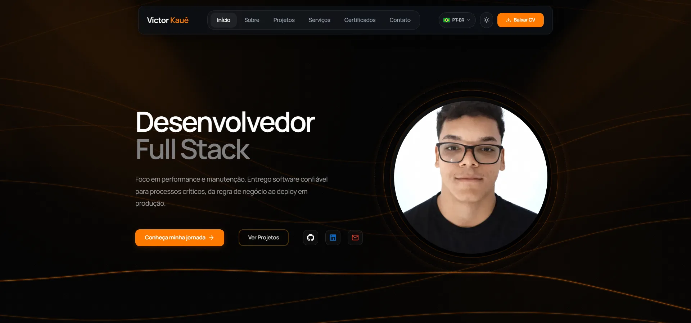
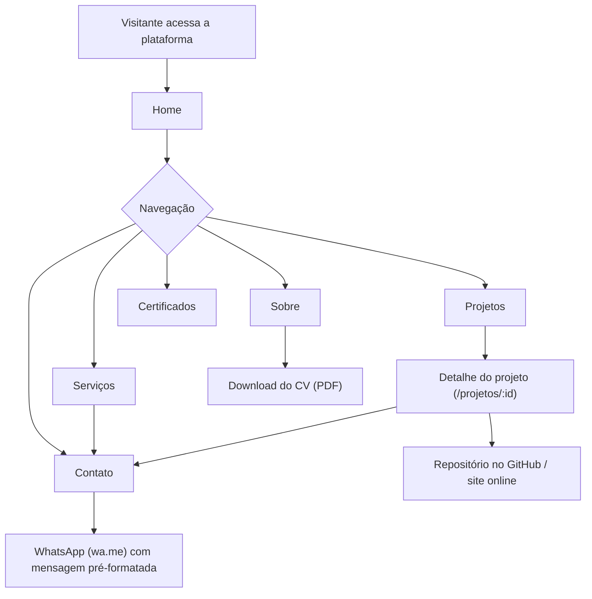
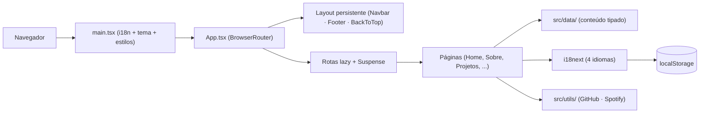
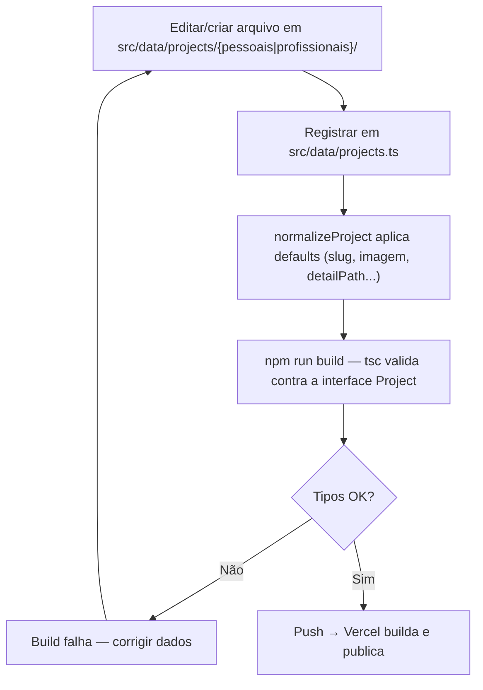
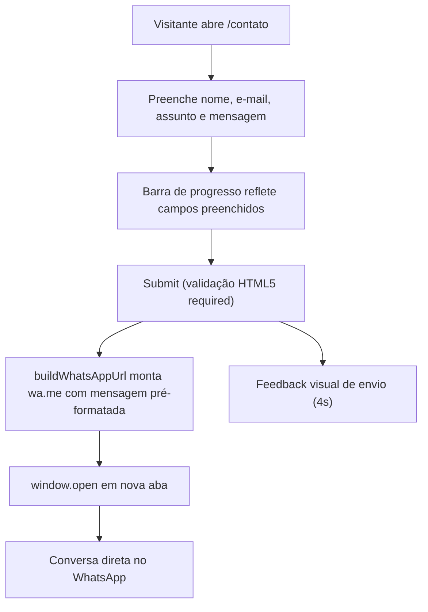
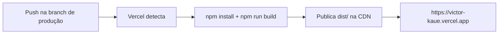

<div align="center">


### Portfólio Full Stack de Victor Kauê

<br />

[](https://victor-kaue.vercel.app/)
[](docs/CHANGELOG.md)

[](https://react.dev/)
[](https://www.typescriptlang.org/)
[](https://vite.dev/)
[](https://tailwindcss.com/)
[](https://www.framer.com/motion/)
[](https://www.i18next.com/)
[](https://playwright.dev/)
[](https://vercel.com/)

🌐 **Produção:** **<https://victor-kaue.vercel.app/>**

</div>

---

## Sumário

- [1. Sobre o projeto](#1-sobre-o-projeto)
- [2. Demonstração / Produção](#2-demonstração--produção)
- [3. Principais funcionalidades](#3-principais-funcionalidades)
- [4. Páginas da aplicação](#4-páginas-da-aplicação)
- [5. Fluxo geral de navegação](#5-fluxo-geral-de-navegação)
- [6. Arquitetura](#6-arquitetura)
- [7. Fluxo do frontend](#7-fluxo-do-frontend)
- [8. Fluxo de conteúdo (dados como código)](#8-fluxo-de-conteúdo-dados-como-código)
- [9. Fluxo de contato](#9-fluxo-de-contato)
- [10. Stack de tecnologias](#10-stack-de-tecnologias)
- [11. Estrutura do projeto](#11-estrutura-do-projeto)
- [12. Como executar localmente](#12-como-executar-localmente)
- [13. Variáveis de ambiente](#13-variáveis-de-ambiente)
- [14. Comandos úteis](#14-comandos-úteis)
- [15. Testes](#15-testes)
- [16. Deploy](#16-deploy)
- [17. SEO, performance e acessibilidade](#17-seo-performance-e-acessibilidade)
- [18. Roadmap](#18-roadmap)
- [19. Documentação complementar](#19-documentação-complementar)
- [20. Autor](#20-autor)
- [21. Contato](#21-contato)

---

## 1. Sobre o projeto

Este portfólio é uma **SPA React (single-page application) estática**, projetada
para mostrar para visitantes — recrutadores, clientes e comunidade técnica — toda a trajetória de Victor Kauê. 
É um projeto **real e em produção**, e a própria aplicação funciona como prova
de competência: arquitetura por camadas, código TypeScript strict, i18n em 4 idiomas,
animações fluidas, smoke E2E e deploy contínuo.

> O contexto de negócio (problema, personas, métricas e escopo) está em
> [`PROJECT_CONTEXT.md`](PROJECT_CONTEXT.md); os requisitos (RF/RNF), fluxos e critérios de
> aceite em [`docs/PRD.md`](docs/PRD.md).

---

## 2. Demonstração / Produção

🌐 **Ambiente de produção:** <https://victor-kaue.vercel.app/>



---

## 3. Principais funcionalidades

### 🧭 Navegação e experiência

- SPA com **transições entre rotas** em CSS (`page-enter`) — sem framer-motion no bundle inicial
- **Lazy loading por rota** com `Suspense` + prefetch no hover (sem tela de loader)
- Fundo animado do Hero em **Canvas 2D** (`FloatingLines`)
- Scroll gerenciado: volta ao topo ao trocar de rota + botão "voltar ao topo"
- Navbar desktop + **navbar mobile dedicada**, tema **claro/escuro** persistido, design tokens
- **Terminal interativo** em `/sobre` (comandos por whitelist, não é um shell)

### 🌐 Conteúdo e internacionalização

- **pt-BR, pt-PT, EN e ES** com i18next; seletor com bandeiras; idioma detectado e **persistido em `localStorage`**
- **Atividade pública do GitHub** (repositórios recentes e contribuições) e bloco de **Spotify**
- Catálogo de projetos com **filtro por categoria** (Todos / Pessoais / Profissionais)
- Página de **detalhe por projeto**: desafio, solução, impacto, arquitetura, stack e screenshots
- Experiências, formação, expertise e serviços renderizados a partir de **dados tipados**
- **Certificados** com visualização e PDFs para download
- **Download do currículo** em PDF


---

## 4. Páginas da aplicação

Oito rotas públicas + 404 — não há autenticação nem perfis (todo o conteúdo é aberto). Fonte
única: [`src/config/pages.ts`](src/config/pages.ts).

| Rota | Página | Conteúdo |
|---|---|---|
| `/` | **Home** | Hero, destaques, marquee de tecnologias e CTAs |
| `/sobre` | **Sobre** | Trajetória, experiências, formação e expertise |
| `/projetos` | **Projetos** | Catálogo com filtro por categoria |
| `/projetos/:id` | **Detalhe do projeto** | Desafio, solução, impacto, arquitetura e stack |
| `/servicos` | **Serviços** | Ofertas de desenvolvimento e consultoria |
| `/certificados` | **Certificados** | Certificações com PDFs |
| `/contato` | **Contato** | Formulário → WhatsApp + links sociais |
| `/uses` | **Uses** | Ferramentas e setup (link no Footer, fora do menu) |
| `*` | **404** | Página "não encontrada" do próprio app |

---

## 5. Fluxo geral de navegação



---

## 6. Arquitetura

Visão geral; detalhes completos em [`docs/ARCHITECTURE.md`](docs/ARCHITECTURE.md).

```
Browser (SPA)
   │  HTTPS  →  https://victor-kaue.vercel.app
   ▼
Vercel (CDN + rewrite SPA em vercel.json)
   ├─ dist/  ←  npm run build (tsc -b + vite build + prerender-meta)
   │               │
   │               ├─ src/pages/      rotas lazy (Home, Sobre, Projetos, ...)
   │               ├─ src/components/ Layout persistente + ui reutilizável
   │               ├─ src/data/       conteúdo tipado (bundled — sem fetch em runtime)
   │               └─ src/locales/    4 idiomas (persistência em localStorage)
   │
   └─ api/spotify/now-playing.js  função serverless opcional (credenciais só no servidor)
```

**Pontos-chave:**

- **Sem backend de aplicação** — nenhum banco, nenhum estado no servidor: hospedagem estática,
  superfície de ataque mínima e custo zero de infraestrutura. A função do Spotify é opcional
  e stateless; sem as variáveis ela responde `501` e o site usa o Embed
  ([ADR-0013](docs/DECISIONS.md)).
- **Conteúdo como código** — dados em `.ts` validados pela interface `Project`
  (`src/types/index.ts`) e normalizados em `src/data/projects.ts`; erro de contrato quebra o
  build, nunca a produção.
- **Contato sem servidor** — o formulário monta um deep-link `wa.me` com a mensagem
  pré-formatada; não há e-mail transacional nem armazenamento de mensagens.
- **Bundle otimizado** — code-splitting por rota + `manualChunks` para vendors
  (react, motion, i18n) no `vite.config.ts`; `react-icons` fica de fora de propósito para
  cada rota carregar só os seus ícones.

Integrações externas: WhatsApp (`wa.me`), GitHub/LinkedIn (links), API pública do GitHub
(leitura anônima, cache em `sessionStorage`), Spotify (Embed + `/api/spotify/now-playing`) e
Vercel Analytics (ver [`docs/API.md`](docs/API.md)).

---

## 7. Fluxo do frontend

O frontend é uma **SPA construída com React 19, Vite e TypeScript**. O fluxo básico:

1. O navegador carrega `index.html` → `src/main.tsx` (fontes, estilos globais, i18n).
2. `App.tsx` monta o `BrowserRouter`, o layout persistente (Navbar, MobileNavbar, Footer,
   BackToTop, ScrollReveal) e o `<Analytics />` da Vercel.
3. O **React Router** resolve a rota; cada página é um chunk **lazy** com `Suspense`.
4. As páginas consomem conteúdo de **`src/data/`** (módulos tipados); só GitHub e Spotify
   são buscados em runtime, via `src/utils/github.ts` e `src/utils/spotify.ts`.
5. Textos passam pelo **i18next** (`t()`); o idioma persiste em `localStorage` (`portfolio-lang`).
6. A transição de página é CSS (`page-enter`); o **framer-motion** fica nos componentes
   interativos (carrossel, lupa, spotlight).



---

## 8. Fluxo de conteúdo (dados como código)

Não há CMS nem banco: atualizar o portfólio = editar dados tipados e fazer push.



Modelo de conteúdo completo (entidades, campos e relações) em [`docs/DATABASE.md`](docs/DATABASE.md).

---

## 9. Fluxo de contato

Sem servidor de e-mail: o formulário converte a mensagem em deep-link do WhatsApp.



Contrato do deep-link documentado em [`docs/API.md`](docs/API.md).

---

## 10. Stack de tecnologias

Versões reais em [`package.json`](package.json).

### Frontend

| Tecnologia | Função |
|---|---|
| **React 19** + React DOM | Construção da interface |
| **TypeScript ~5.7** | Tipagem estática (strict) |
| **Vite 6** | Build e desenvolvimento |
| **TailwindCSS 4** (`@tailwindcss/vite`) + `tw-animate-css` | Estilização utilitária |
| CSS por componente + design tokens (`src/styles/variables.css`) | Temas claro e escuro |
| **react-router-dom 7** | Roteamento SPA com lazy routes |
| **framer-motion 12** | Animações dos componentes interativos |
| Canvas 2D (`FloatingLines`) | Fundo animado do Hero |
| **i18next** + `react-i18next` + language detector | Internacionalização (pt-BR, pt-PT, EN, ES) |
| `country-flag-icons` | Bandeiras SVG do seletor de idioma |
| `react-icons` (Simple Icons + Feather) | Ícones |
| Manrope `.woff2` em `public/fonts/` | Fonte self-hosted (preload no `index.html`) |
| `@vercel/analytics` | Métricas de visita |

### Build / Infra

| Tecnologia | Função |
|---|---|
| **Vercel** | Hospedagem estática + função serverless (`api/`) + deploy contínuo por push |
| `tsc -b` + `vite build` | Checagem de tipos + bundle de produção |
| `manualChunks` (react, motion, i18n) | Split de vendors para cache eficiente |
| Node.js (`scripts/prerender-meta.mjs`) | `<head>` por rota + `sitemap.xml` pós-build |
| `sharp` (`scripts/optimize-images.mjs`) | Variantes `.webp` responsivas |
| **Playwright** | Smoke E2E contra o build de produção |
| `react-doctor` · `react-scan` | Diagnóstico de código e de re-render |

---

## 11. Estrutura do projeto

```
meu_portifolio/
├── api/
│   └── spotify/now-playing.js     # função serverless opcional (Vercel)
├── public/
│   ├── Certificados/pdfs/         # PDFs de certificados (+ capas .webp)
│   ├── docs/Curriculo/            # Currículo em PDF
│   ├── fonts/                     # Manrope .woff2 (self-hosted)
│   └── images/                    # fotos de projetos, galeria, backgrounds (.webp)
├── scripts/
│   ├── optimize-images.mjs        # variantes .webp responsivas (npm run images:optimize)
│   └── prerender-meta.mjs         # <head> por rota + sitemap.xml pós-build
├── src/
│   ├── components/
│   │   ├── Layout/                # Navbar (+ MobileNavbar), Footer, BackToTop, ScrollToTop, ScrollReveal
│   │   └── ui/                    # Button, PageHero, ProjectCard, FloatingLines, Terminal, Spotify…
│   ├── config/                    # pages.ts (registro único de rotas), navIcons, site, spotify
│   ├── data/
│   │   ├── projects/pessoais/     # um arquivo .ts por projeto pessoal
│   │   ├── projects/profissionais/# um arquivo .ts por projeto profissional
│   │   └── *.ts                   # experiences, education, expertise, services, social…
│   ├── hooks/                     # useSeo, useLanguage, useScrollPosition…
│   ├── locales/                   # languages.ts + textos por idioma/tela (pt-BR, pt-PT, en, es)
│   ├── pages/                     # uma pasta por rota (.tsx + .css)
│   ├── styles/                    # variables, reset, global, animations
│   ├── theme/                     # ThemeProvider (claro/escuro)
│   ├── types/index.ts             # contratos (Project, Experience, …)
│   ├── utils/                     # github.ts, spotify.ts, imageSrcSet…
│   ├── i18n.ts                    # inicialização do i18next + detecção de idioma
│   ├── App.tsx  main.tsx
│   └── vite-env.d.ts
├── tests/e2e/                     # smoke Playwright
├── docs/                          # documentação técnica
├── CLAUDE.md · PROJECT_CONTEXT.md
├── index.html · vite.config.ts · vercel.json · playwright.config.ts · tsconfig*.json
└── README.md                      # você está aqui
```

| Pasta | O que contém |
|---|---|
| `src/data/` | **Fonte de verdade do conteúdo** — módulos TS tipados, sem fetch em runtime |
| `src/components/` | Layout persistente e blocos de UI reutilizáveis (um componente por pasta) |
| `src/pages/` | Uma pasta por rota; monta seções e consome `src/data/` |
| `src/config/` | Registros únicos (rotas, SEO, sitemap, ícones do menu) |
| `src/locales/` | Textos da UI em 4 idiomas; pt-BR é a base de tipos |
| `api/` | Função serverless do Spotify — única peça server-side, opcional |
| `tests/e2e/` | Smoke Playwright contra o build de produção |
| `public/` | Assets estáticos: imagens `.webp`, fontes, PDFs de certificados e currículo |
| `scripts/` | Utilitários Node de build-time |
| `docs/` | Documentação viva (arquitetura, dados, deploy, ambiente…) |

---

## 12. Como executar localmente

**Pré-requisitos:** Node.js 18+ (LTS recomendado) · npm · Git.
Sem Docker, sem banco, sem chaves — clona e roda.

```bash
# 1. Clonar o repositório
git clone https://github.com/Victorkaue333/Portifolio-VictorKaue.git
cd Portifolio-VictorKaue

# 2. Instalar dependências
npm install

# 3. Rodar em desenvolvimento
npm run dev
```

- App: <http://localhost:5173> (abre automaticamente)

> Build de produção local: `npm run build` e depois `npm run preview`.

---

## 13. Deploy

Produção na **Vercel** com deploy contínuo por push. Guia completo em
[`docs/DEPLOY.md`](docs/DEPLOY.md).



- **Build command:** `npm run build` · **Output:** `dist/`
- **Função serverless:** a Vercel publica `api/` junto; as variáveis do Spotify (opcionais) ficam
  em *Project → Settings → Environment Variables*.
- **Rollback:** dashboard Vercel → *Deployments* → **Promote to Production** em um deploy
  anterior (instantâneo, sem rebuild).
- **Roteamento SPA:** [`vercel.json`](vercel.json) reescreve rotas profundas (ex.:
  `/projetos/:id`) para `index.html`, exceto `api/`, assets e arquivos estáticos, e define cache
  imutável para `/assets` e `/fonts`.

---


## 14. Documentação complementar

Este repositório segue o padrão de **11 documentos obrigatórios**: documentos vivos,
versionados junto ao código.

**Na raiz:**

| Documento | Conteúdo |
|---|---|
| [PROJECT_CONTEXT](PROJECT_CONTEXT.md) | Contexto de negócio: problema, personas, métricas e escopo |
| [CLAUDE](CLAUDE.md) | Regras para a IA: stack, comandos, convenções e guardrails |

**Em [`docs/`](docs/):**

| Documento | Conteúdo |
|---|---|
| [PRD](docs/PRD.md) | Produto, requisitos (RF/RNF), fluxos e critérios de aceite |
| [ARCHITECTURE](docs/ARCHITECTURE.md) | Arquitetura da SPA, camadas e integrações |
| [API](docs/API.md) | Contratos externos (WhatsApp, GitHub) + endpoint `/api/spotify/now-playing` |
| [DATABASE](docs/DATABASE.md) | Modelo de conteúdo estático (entidades e relações) |
| [DEPLOY](docs/DEPLOY.md) | Vercel, pipeline, rollback e checklist |
| [ENVIRONMENT](docs/ENVIRONMENT.md) | Variáveis de ambiente (só as opcionais do Spotify) |
| [DESIGN](docs/DESIGN.md) | Design system: tokens, tipografia, componentes |
| [DECISIONS](docs/DECISIONS.md) | Decisões técnicas (ADRs) e histórico |
| [CHANGELOG](docs/CHANGELOG.md) | Histórico de mudanças por versão (SemVer) |

---


## 15. Contato

[](https://github.com/Victorkaue333)
[](https://www.linkedin.com/in/victor-kaue-419926364/)
[](mailto:kaue.alves.pg@gmail.com)
[](https://wa.me/5587981774951)

---

<div align="center">

> Última revisão alinhada à v2.0.0.

</div>
