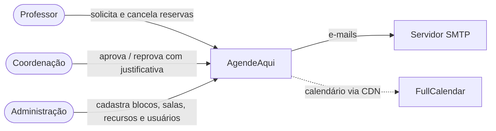
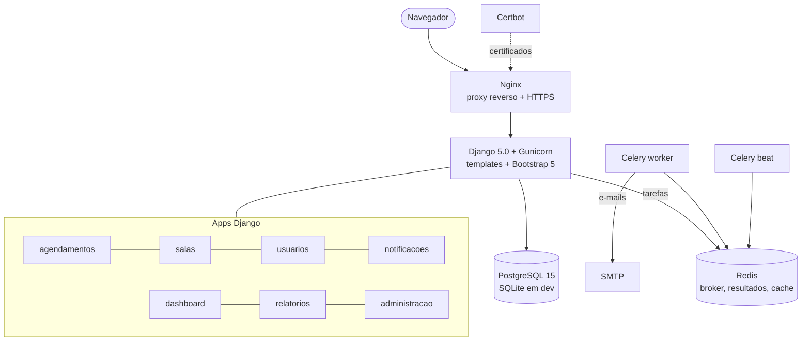
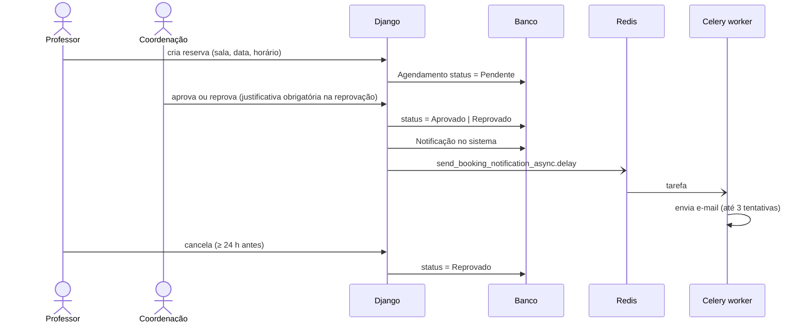
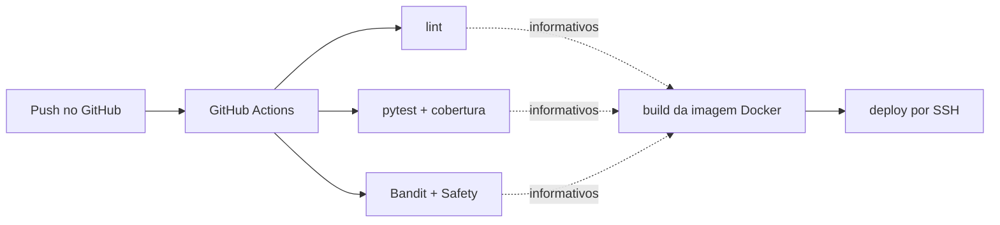

# AgendeAqui — diagramas

Fonte: `github.com/Victorkaue333/AgendeAqui`, branch padrão `desenv`
(último commit 18/01/2026). Já existe um diagrama ER conceitual no repositório,
publicado na galeria (`diagrama-er.webp`).

## 1. Contexto

## 2. Containers

Nota: Nginx e Certbot estão declarados no `docker-compose.yml`, mas as
configurações montadas não estão no repositório — desenhar com borda tracejada.

## 3. Sequência — solicitação e aprovação

Não desenhar validação de conflito de horário: ela foi removida do branch
padrão (ver auditoria §3.8).

## 4. Deploy / CI

Legenda: lint/Bandit/Safety estão com `continue-on-error` — não bloqueiam o
build (seta tracejada).
