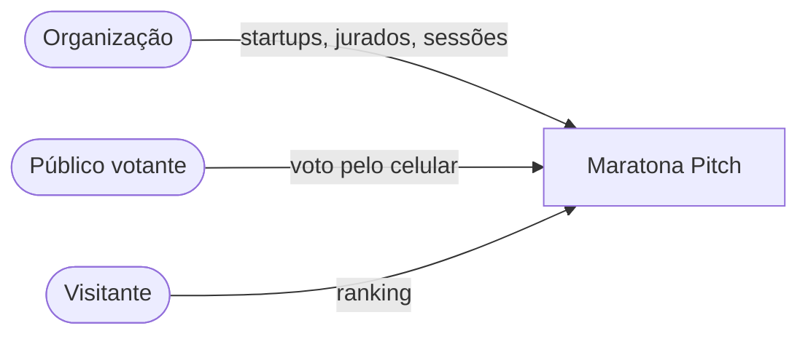
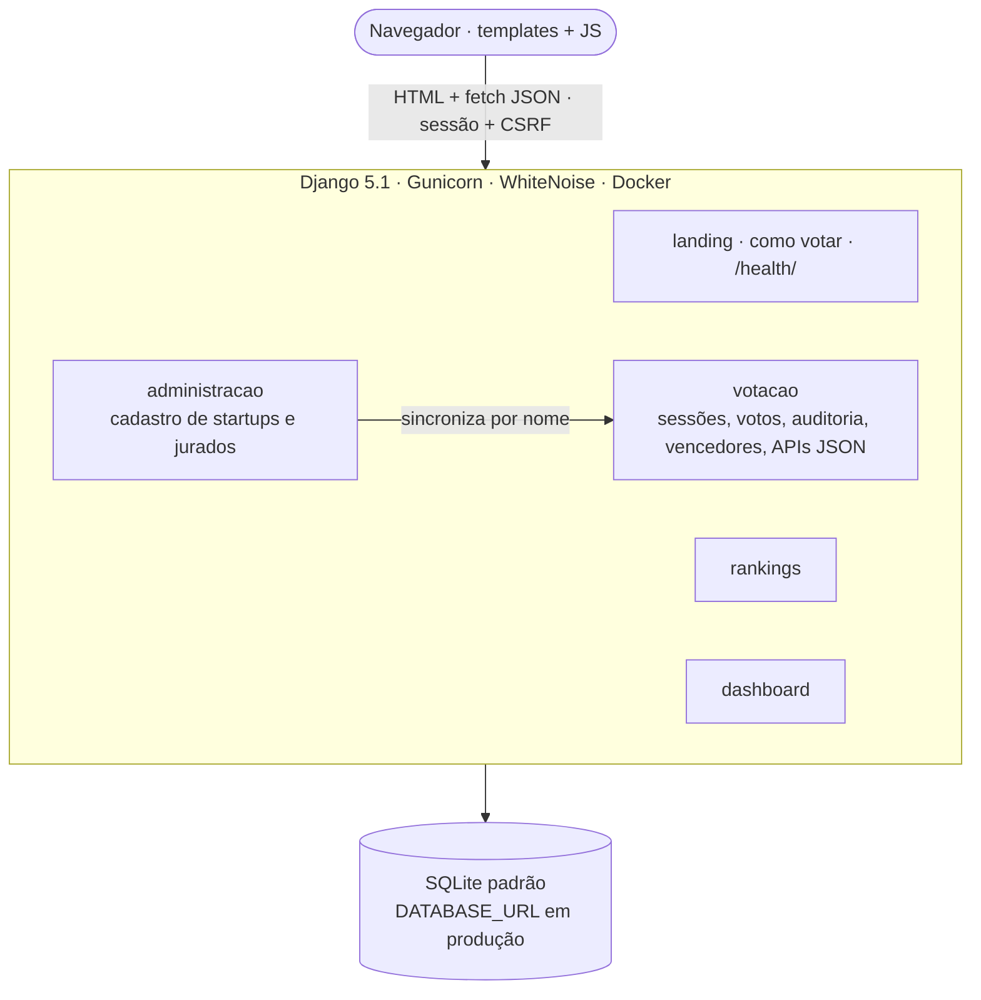
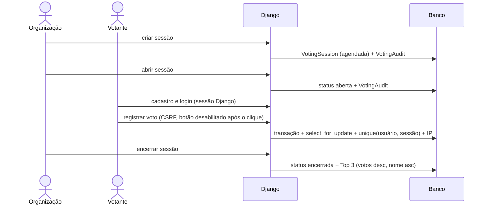

# MaratonaTech (plataforma Maratona Pitch) — diagramas

Fonte: `Maratona-IFSert-oTECH-Ano-IV/MaratonaPitch/` (Django). O código da
aplicação não está versionado neste clone (pasta não rastreada); o histórico
original é citado na documentação. Sistema encerrado no código desde dez/2025.

Não incluir: a "nova geração" (Next.js/NestJS/Prisma) como se existisse — só
como planejado, tracejado, se for desenhada. Não incluir credenciais nem rotas
com risco documentado.

## 1. Contexto

## 2. Componentes

## 3. Sequência — inscrição → votação → apuração

