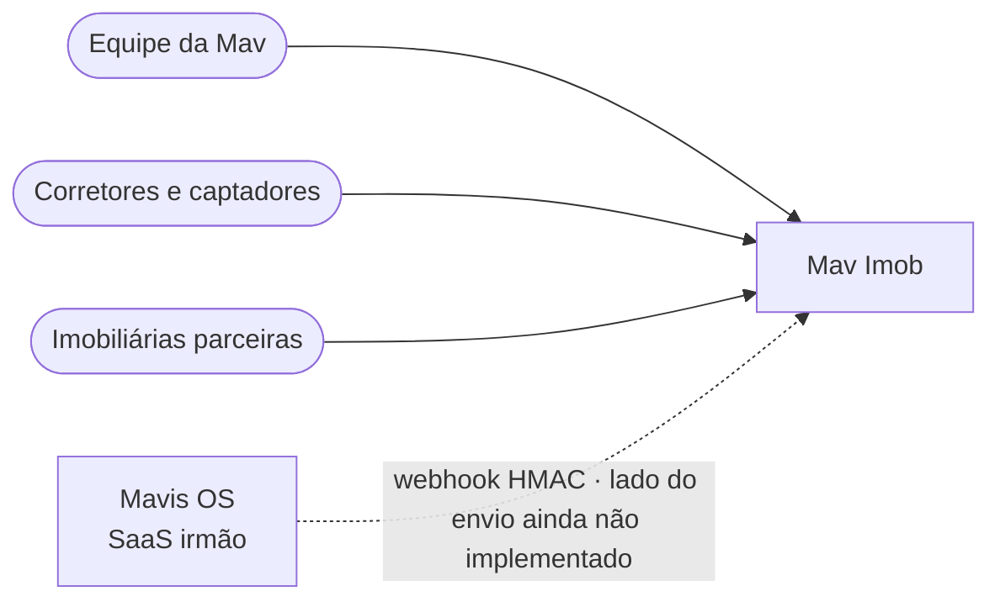
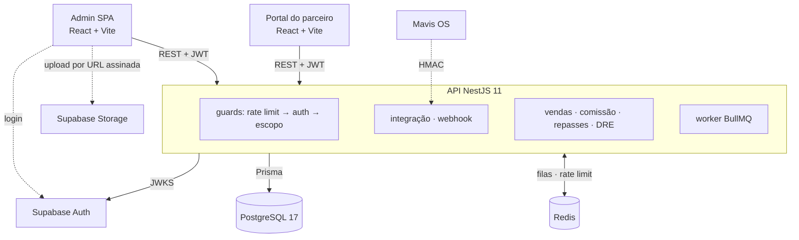

# Mav Imob — diagramas

Fonte: repositório privado `aex-hub/mavis-mob` (branch `release`, 19/10/2026).
Código proprietário da AEX Hub Capital: **publicar só com autorização**.

Não incluir em hipótese alguma: percentuais de comissão, metas, nomes de
imobiliárias parceiras ou tenants, domínio, nomes de planos, hosts de deploy.

## 1. Contexto

## 2. Containers

Acento laranja sugerido: `DOM` (função única de comissão com Decimal
half-even e teste-guardião no CI).
