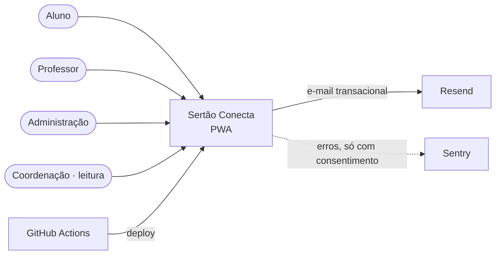
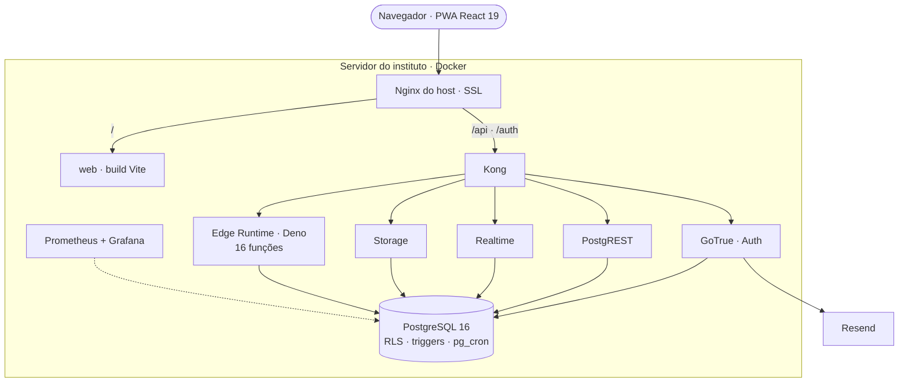
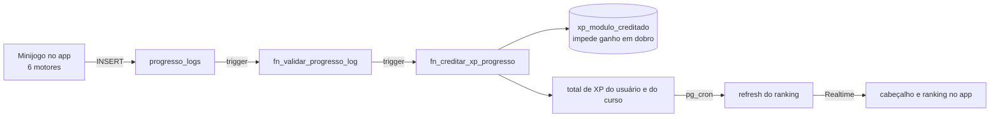
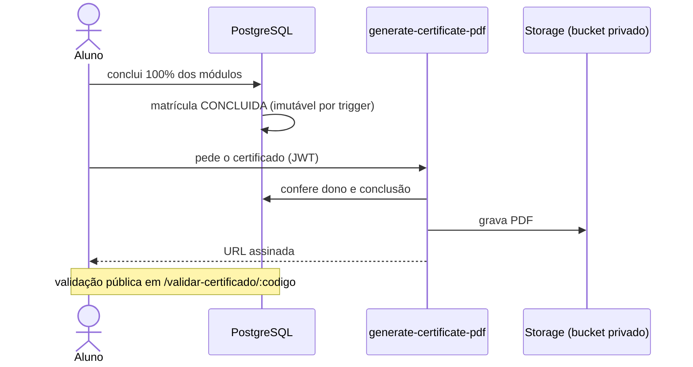
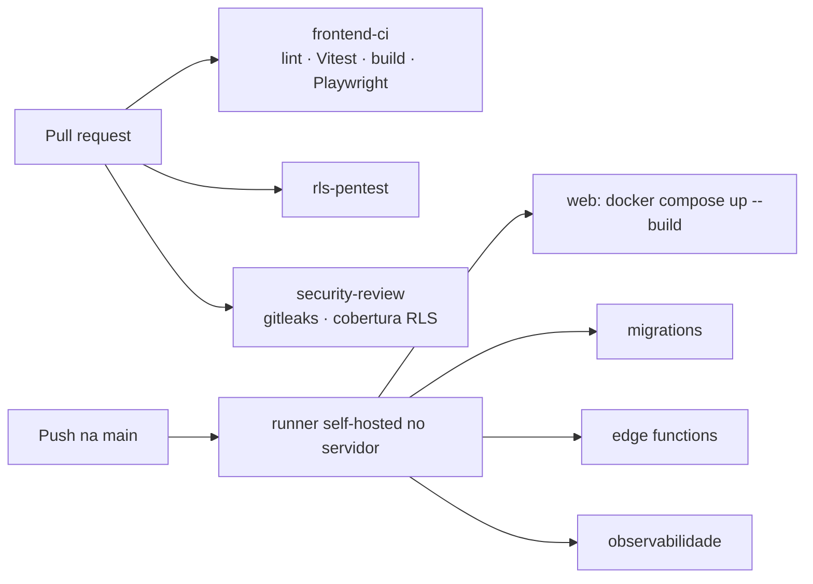

# Sertão Conecta — diagramas

Fonte: repositório privado `sertao-conecta` (HEAD de 26/09/2026). Publicação
depende de confirmação com o IF Sertão-PE. Não incluir: IP, especificação do
servidor, nomes de host internos, dados de alunos.

## 1. Contexto

## 2. Containers (servidor do instituto)

## 3. Gamificação (regras no banco)

## 4. Certificado

## 5. CI/CD

Crédito no diagrama de componentes do app (se for desenhado): motores de
minijogo e player de vídeo foram da Giselle Novaes.
