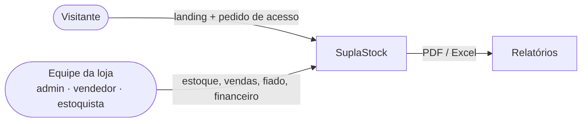
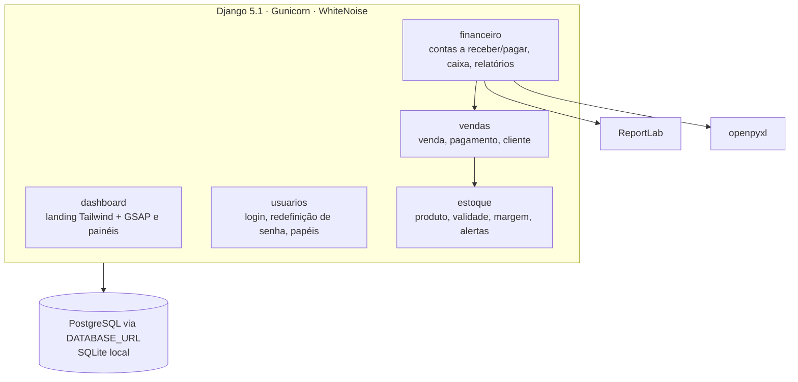
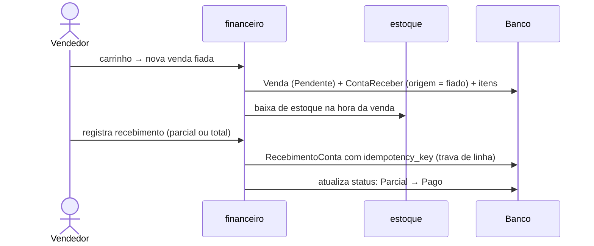
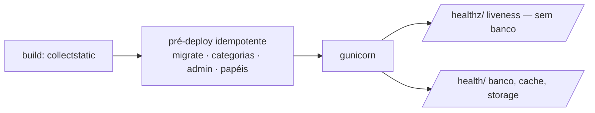

# SuplaStock — diagramas

Fonte: `github.com/Victorkaue333/SuplaStock` (branch `main`, a5d4bf4).
Pendente: confirmar com o autor se é o mesmo sistema entregue à VA Suplementos
(o código foi renomeado de `va_suplementos`). Não nomear o cliente nos
diagramas até lá.

## 1. Contexto

## 2. Módulos (apps Django)

## 3. Fluxo — venda fiada

## 4. Deploy (Railway)

Não incluir: Nginx (existe pasta, mas a Railway roda o Gunicorn direto) e DRF
(citado no README, não está nas dependências).
