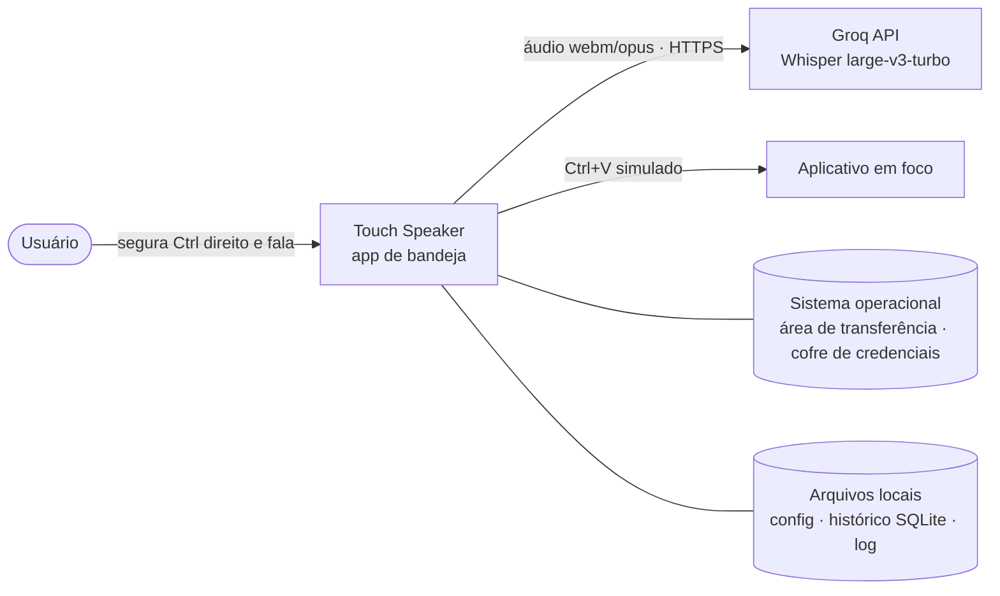
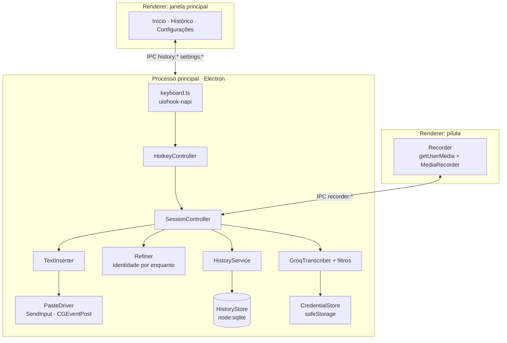
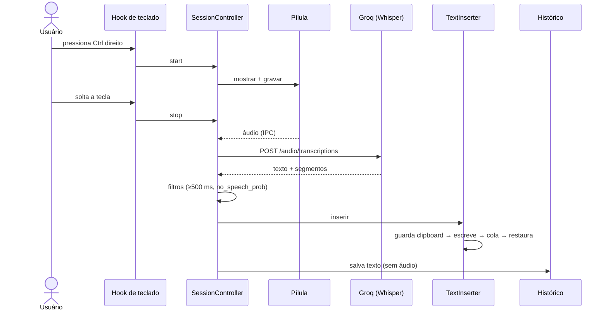
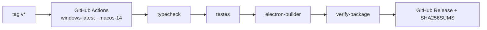

# Touch Speaker — diagramas

Fonte: `github.com/Victorkaue333/touch-speaker` (v0.1.2). O repositório já
tem diagramas Mermaid em `ARCHITECTURE.md` e no README; estes seguem o mesmo
código, no padrão visual do portfólio.

## 1. Contexto

## 2. Componentes (processo principal + renderers)

## 3. Sequência — um ditado

## 4. Release

Legenda: o build macOS é gerado no CI mas não foi testado num Mac.
